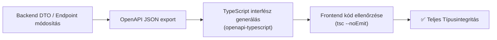

# API-TypeSync: Automata API Séma és Típus Szinkronizáció

## Célkitűzés
Megszüntetni az eltérést a backend adatmodellek/végpontok és a frontend (TypeScript) kliensek között,
garantálva a teljes körű típusbiztonságot az API határon.

---

## 1. OpenAPI / Swagger Export Protokoll

Backend végpont vagy DTO módosítása után mindig generáld újra az OpenAPI specifikációt:

### FastAPI (Python)
```bash
# OpenAPI JSON generálása parancssorból
python -c "import json; from main import app; print(json.dumps(app.openapi(), indent=2))" > openapi.json
```

### NestJS / Express / Node.js
```bash
# Ha van export script konfigurálva:
npm run export:openapi
```

---

## 2. Frontend Típusok Automatikus Generálása

Az `openapi.json` vagy `openapi.yaml` fájlból közvetlenül generálj statikus TypeScript típusokat:

### Eszköz: `openapi-typescript`
```bash
npx openapi-typescript openapi.json -o src/types/api-schema.d.ts
```

### Előnyök:
- Nincs szükség kézi másolgatásra a backend modellek és a frontend interfészek között.
- Ha a backendben megváltozik egy mező neve vagy típusa, a TypeScript fordító (`tsc --noEmit`) azonnal megjelöli a frontendben a hibás hivatkozásokat.

---

## 3. Zárt Hurkú Szinkronizációs Folyamat


