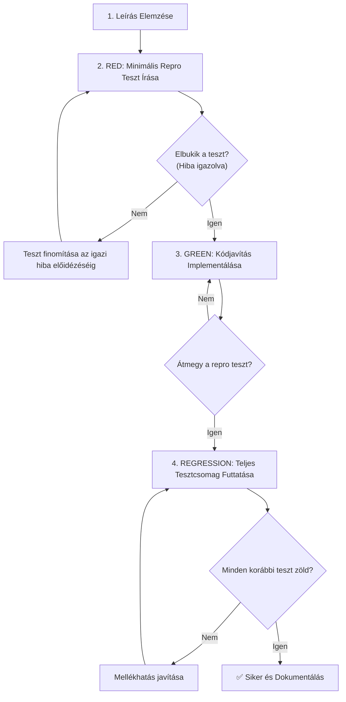

# Reproduce-Issue: SOTA Hibajavítási és TDD Protokoll

## Filozófia: "Reproduce First, Fix Later"

A SWE-bench kutatások rávilágítottak arra, hogy az autonóm ágensek hibajavításainak mintegy 30%-a
regressziót okoz vagy valójában nem a gyökérokot (root cause) kezeli, ha azonnal kódjavításba kezdenek.
Ez a skill kötelezővé teszi a 4-lépcsős zárt hurkú reprodukciós ciklust.

---

## A 4-Lépcsős Ciklus (RED -> GREEN -> REFACTOR -> REGRESSION CHECK)



---

## Részletes Lépések

### 1. Lépés: Minimális Reprodukciós Teszt (RED)
- Hozz létre egy izolált tesztfájlt (pl. `tests/repro_issue_<leírás>.py` vagy `.ts`).
- A tesztnek **kizárólag** a bejelentett hibás viselkedést kell hívnia a minimális bemeneti adatokkal.
- **Futtasd le a tesztet**: Meg KELL buknia (assertion error, unhandled exception vagy rossz visszatérési érték).
- Ha a teszt elsőre átmegy: a feltételezésed téves, a hiba más körülmények között lép fel. Keresd meg a pontos peremfeltételt!

### 2. Lépés: Célzott Javítás (GREEN)
- A `code-edit` SEARCH/REPLACE kaszkád használatával hajts végre minimális, pontos kódmódosítást.
- Kerüld a felesleges refaktorálást ebben a lépésben: csak azt javítsd, ami a teszt zölddé válásához kell.
- Futtasd újra a repro tesztet.

### 3. Lépés: Kód Tisztítás (REFACTOR)
- Miután a teszt zöld, ellenőrizd az új kód minőségét (típusok, felesleges debug logok eltávolítása).
- A repro tesztet tartsd meg végleges regressziós tesztként a repozitóriumban.

### 4. Lépés: Teljes Regressziós Ellenőrzés
- Futtasd le a projekt teljes tesztcsomagját (`pytest`, `npm test`, `cargo test`, `go test` stb.).
- Csak akkor tekinthető késznek a feladat, ha:
  1. A repro teszt zöld.
  2. Egyetlen korábbi teszt sem romlott el.

---

## Nyelvspecifikus Minták

### Python (Pytest)
```python
# tests/test_repro_123.py
import pytest
from myapp.service import calculate_discount

def test_negative_quantity_raises_value_error():
    """Reproduces issue #123: negative quantity should not produce invalid discount."""
    with pytest.raises(ValueError, match="Quantity cannot be negative"):
        calculate_discount(price=100, quantity=-1)
```

### TypeScript / Jest / Vitest
```typescript
// tests/repro_123.test.ts
import { describe, it, expect } from 'vitest';
import { parseUserInput } from '../src/parser';

describe('Issue #123 Reproduction', () => {
  it('should handle unescaped unicode characters gracefully', () => {
    const input = 'invalid\u0000payload';
    expect(() => parseUserInput(input)).not.toThrow();
  });
});
```
